# Where The Heat At? 🔥
### Tracing California Current Marine Heatwaves with Surface Drifters

**DATA3001 Group Sushi 🍣** · Ariana M.D (z5575536), Arjun S. (z5587695), Ivory P. (z5479633), Jingxiao Q. (z5533951), Sarah S. (z5481592)

**Industry partner:** NOAA Global Drifter Program (GDP) · **Data:** GDP hourly drifters, NOAA OISST v2.1, CalCOFI CUFES egg surveys

**Contents:** [Abstract](#abstract) · [1. Introduction](#1-introduction) · [2. Background](#2-background-and-motivation) · [3. Problem formulation](#3-problem-formulation) · [4. Literature](#4-literature-review-and-existing-approaches) · [5. Gaps](#5-research-gaps) · [6. Contributions](#6-research-contributions) · [7. Methodology](#7-methodology) · [8. Analysis](#8-analysis-and-discussion) · [9. Results](#9-results-and-findings) · [10. Limitations](#10-limitations) · [11. Future work](#11-future-work) · [12. Installation and reproducibility](#12-installation-and-reproducibility) · [References](#references) · [Appendices](#appendix-a-rq2-supplementary-analyses)

## Abstract
The California Current is again in a large marine heatwave while a strong El Niño develops through 2026–27. Satellite tools such as NOAA's Blobtracker show where the ocean is warm, but not where warm water moves or what it reaches. This study uses over 1.4 million hourly observations from 341 Global Drifter Program (GDP) drifters (2012–2021), the OISST satellite record and over 17,000 CalCOFI fish-egg samples to compare two similar-sized events: the damaging 2013–2016 “Blob” and the 2019–2020 heatwave, which stayed offshore. Three questions were asked. RQ1 (detect): a drifter detector using the OISST 90th-percentile threshold agreed with OISST heatwave days better than a fixed +1 °C rule (F1 0.873 vs 0.819) and carried over best to the unseen 2019–20 events. RQ2 (track): warm-condition drifters sat closer to shore during the Blob (median 467 vs 800 km) and entered the 50 km coastal zone about eight times as often; a recent-velocity model gave the best 24-hour position forecasts (median error about 9 km). RQ3 (impact): about four times more spring spawning habitat was in a heatwave during the Blob (44% vs 10% of samples), and sardine spawning moved roughly 8° north while staying in about 12.8 °C water. Adding heatwave exposure improved predictions of where sardine eggs occur in all three model sets compared (best: gradient boosting, ROC-AUC 0.72), but not for anchovy. Drifters are recommended alongside the Blobtracker as a local check on coastal heatwaves, and warm water moving towards the shore should be treated as an early signal for sardine spawning grounds.

## 1. Introduction
This study tests whether surface drifters can add something satellite heatwave maps cannot: where unusually warm water goes, whether it reaches the coast, and what that means for fish. The industry partner is NOAA's Global Drifter Program (GDP), which keeps around 1,300 satellite-tracked buoys drifting in the world's surface ocean. Each drifter reports its position, velocity, and sea-surface temperature (SST) every hour (Elipot et al., 2016; UNSW DATA3001, 2026).

Ocean observations are of two kinds. Eulerian instruments, such as moorings and satellites, watch fixed places. Lagrangian instruments, such as drifters, move with the water and report what it experiences along the way. Marine heatwave monitoring today is almost entirely Eulerian: NOAA's California Current Marine Heatwave Tracker ("Blobtracker") maps daily satellite SST anomalies on a fixed grid. A drifter instead follows a parcel of water, so in principle it can show whether a patch of warm water is moving towards the coast.

The study area is the California Current off the U.S. West Coast, which is currently in a large marine heatwave (NEP25A) as a strong El Niño develops. The GDP hourly record available from clouddrift ends in October 2022, so it cannot follow NEP25A directly. Instead, drifter-based methods are built and tested on two past events fully covered by the data: the 2013–2016 “Blob”, which reached the coast and disrupted fisheries, and the 2019–2020 heatwave, which was nearly as large but stayed offshore (Weber et al., 2021). Comparing a damaging event with a less damaging one is a stronger test than validating on a single event.

## 2. Background and Motivation
The California Current is in a record-breaking heatwave just as a strong El Niño arrives. NOAA has tracked NEP25A as a contiguous feature since May 2025. It reached about 10 million km² on 10 September 2025, the largest heatwave by area in the Northeast Pacific since monitoring began in 1982 (NOAA California Current IEA, 2026). As of late October 2026, NOAA reports that it has expanded and intensified off the southern West Coast as El Niño-driven Kelvin waves arrive. NOAA's Climate Prediction Center issued an El Niño Advisory on 8 October 2026, giving a greater than 83% chance of a strong-to-very strong El Niño through January–March 2027 (NOAA Climate Prediction Center, 2026).

**Why warm water at the coast matters.** The California Current is a wind-driven upwelling system. Equatorward winds push surface water offshore, cold nutrient-rich water rises to replace it, and that nutrient supply feeds one of the world's most productive fisheries. A marine heatwave caps the surface with warm water and weakens this supply. El Niño adds warming and further suppresses upwelling. NOAA notes that the heatwave and El Niño may not simply add together; the larger risk may be how long the coast stays warm (NOAA California Current IEA, 2026).

The Blob formed in the Gulf of Alaska in winter 2013–14 from reduced ocean heat loss (Bond et al., 2015), persisted for several years, and by 2015, stretched from Alaska to Baja California. Its effects included northward shifts of tropical species, closures of commercially important fisheries, a record harmful algal bloom, and mass strandings of marine mammals and seabirds (Cavole et al., 2016). Sardine and anchovy swung between record lows and highs in this period (Thompson et al., 2022).

**What is at stake for fisheries and coastal economies.** The Blob led to a series of U.S. federal fishery disaster declarations along the West Coast, covering Pacific cod, urchin and abalone, salmon, crab and sardine, and over \$141 million USD in relief funds to affected fishers, processors, and dealers (Free et al., 2023).

El Niño is already hitting anchovy fisheries elsewhere in the Pacific in 2026. Peru, the world's largest anchovy producer, landed only 2,496 tonnes of anchovy in July 2026, a 99.1% fall from 292,148 tonnes in July 2025, according to national production statistics (INEI, reported by Salazar, 2026). In its September 2026 inflation report, Peru's central bank projected a 30.7% contraction of the fishing sector for 2026. Research commissioned by Peru's National Fisheries Society puts about 78,000 fishing-sector jobs at risk in 2026 and another 44,000 in 2027 (Salazar, 2026). Peru's anchovy lives in a different current system (the Humboldt), but the mechanism is the same one this project studies: warm water suppressing the upwelling that small fishes depend on.

The current West Coast event carries similar risks. NOAA Fisheries and partners are tracking NEP25A because marine heatwaves can trigger harmful algal blooms that sicken marine mammals and close shellfish fisheries, and past heatwaves, including the Blob, have been linked to lower ocean survival of salmon (Responsible Seafood Advocate, 2026). An early harmful algal bloom off Southern California in 2025 killed hundreds of sea lions, dolphins, and seabirds, and large numbers of tuna were caught in Alaska in autumn 2025, an area where they are not normally found in such numbers (Responsible Seafood Advocate, 2026).

**Why fish spawning matters (RQ3).** A heatwave map only helps fisheries if it connects to the species they depend on. Pacific sardine and northern anchovy are the main forage fish of the California Current: prey for larger fish, marine mammals and seabirds, and the basis of commercial fisheries. Both reacted strongly to the Blob, in opposite directions. Sardine collapsed before and during the heatwave, leading to a multi-year federal fishery disaster and closure from California to Washington, while anchovy began increasing during the heatwave and reached near-record levels afterwards (Free et al., 2023). Sardine shifted its distribution markedly; anchovy largely stayed in its usual spawning areas (Muhling et al., 2020).

These opposite responses raise the question RQ3 asks: was the sardine shift linked to the warm water itself, and could heatwave exposure near the coast flag where spawning is likely to move? Answering it needs fish observations that overlap the heatwaves in time and place. Spawning is also where temperature matters most for future catches, because adults choose where to release eggs, and egg and larval survival sets the size of later year classes (Robidas et al., 2026). A review of the Blob's effects on West Coast fisheries recommends expanding monitoring to provide early warning signals of impacts (Free et al., 2023). A drifter-based measure of heatwave exposure on spawning grounds is one such signal.

**Why two similar events had different outcomes.** The 2019–2020 heatwave was nearly as large as the Blob but stayed far offshore, while the strong upwelling kept the northern California Current cool and productive (Weber et al., 2021). Size alone therefore does not predict impact. What matters is where the warm water goes and what it reaches.

NOAA scientists make the same point about the current event. Andrew Leising, who runs the Blobtracker, notes that NEP25A has rivalled the Blob in area but so far had much less ecological impact, because it has not reached as deep into the water column and has not spent as much time near the coast (Responsible Seafood Advocate, 2026). Time near the coast is exactly what drifters can measure.

**Who can use this study.**

- **NOAA and the GDP:** the project tests a new use of an existing observing network, as a low-cost, real-time check on heatwave conditions where drifters are.

- **Fisheries managers:** it asks whether heatwave exposure near the coast is linked to where commercially important fish spawn.

- **Ocean science:** it compares Lagrangian and Eulerian views of the same events.

## 3. Problem Formulation
The project is framed as a chain: detect warm water with drifter data, track where it travels, then measure its impact on fish. Each link is one research question, answered by comparing more than one model with a metric suited to that question.

|              | Research Question                                                                                                                                                                                                                                       | Model’s purpose                                                                                    | Metric                                                         |
|--------------|---------------------------------------------------------------------------------------------------------------------------------------------------------------------------------------------------------------------------------------------------------|----------------------------------------------------------------------------------------------------|----------------------------------------------------------------|
| RQ1 - Detect | Can GDP drifter SST observations detect and track the timing and spatial distribution of the 2013–2016 Blob and the 2019–2020 marine heatwave in the California Current, and how closely do these observations agree with OISST and NOAA’s Blobtracker? | Classifying each drifter observation as a heatwave or not                                          | Precision, recall, F1 against OISST heatwave days              |
| RQ2 · Track  | How did the movement and coastal exposure of anomalously warm water differ between the 2013–2016 Blob and the 2019–2020 marine heatwave?                                                                                                                | Compare coastal proximity; predict 24-hour drifter positions and assess warm/non-warm persistence. | Distance to coast, coastal-entry rate, position error (km), F1 |
| RQ3 · Impact | How did coastal heatwave exposure overlap the preferred temperature ranges of sardine and anchovy, and was it associated with changes in where they spawned?                                                                                            | Measure exposure of spawning habitat; predict egg presence                                         | leave-one-year-out ROC-AUC                                     |

**Scope.** The study box is 25–48°N, 135–115°W, from 2012 to 2021. The Blob period is 2013–2016 (2014–2016 for fish, after the Blob reached the region) and the second event is 2019–2020. A marine heatwave is defined throughout as OISST SST above its local, day-of-year 90th percentile for at least five consecutive days (Hobday et al., 2016).

**Study region.** The California Current runs along the U.S. West Coast from Washington to Baja California. The study box covers both the nearshore band and the offshore water where the two events were active. Coastal water here is shaped by seasonal upwelling, which brings cold, nutrient-rich water to the surface, while offshore currents carry warmer water. Changes in temperature, nutrients and circulation affect where species live and how well they reproduce.

The region was chosen because it has dense drifter coverage, giving direct measures of SST, position and movement, and because it supports commercially important species such as anchovy, sardine and mackerel, whose distributions depend on ocean temperature. NOAA fish-egg surveys in the same area make it possible to link the heatwaves to spawning.

**Product.** Using GDP drifter data to create:

- Heatwave flag for each drifter observation

- Coastal-exposure and short-term movement forecasts

- Exposure measure for fish spawning habitat, together with the evaluation of each.

## 4. Literature Review and Existing Approaches
Some existing work gave a standard heatwave definition, an operational tracker, a validated drifter dataset and detailed accounts of both events; however, none of it combines drifter movement, heatwave detection and fish observations.

**Defining marine heatwaves.** Hobday et al. (2016) define a marine heatwave as a period of at least five days with SST above the 90th percentile of a 30-year climatology for that location and day of year. Because the threshold varies by place and season, the definition works in both warm southern and cold northern water. It is the standard in the field and is used for every research question. NOAA's Blobtracker uses a related area-based rule: a large heatwave is a contiguous region where the normalised SST anomaly exceeds 1.29 standard deviations, covering more than 400,000 km² (NOAA California Current IEA, 2026). The two definitions answer different questions, one per grid cell and one per event, so their timing and location are compared rather than expecting identical flags.

**Satellite SST.** NOAA's Daily Optimum Interpolation SST (OISST) v2.1 blends satellite, ship and buoy measurements, including drifters, onto a daily 0.25° grid from 1982 (Huang et al., 2021). It is the reference for both the Blobtracker and this study. Because it already assimilates drifter SST, agreement between drifters and OISST is a consistency check, not fully independent validation.

**Drifter data.** Elipot et al. (2016) describe the GDP hourly product, including how hourly positions and velocities are derived. Elipot et al. (2022) document the hourly SST product and its quality flags. The clouddrift Python package gives cloud access to these data as "ragged arrays" (Elipot et al., 2024). Drifters can lose their drogue (sea anchor); after that they follow the wind as well as the current, which matters for movement analysis.

**The two events.** Bond et al. (2015) traced the Blob to reduced ocean heat loss in winter 2013–14, and Di Lorenzo and Mantua (2016) showed why it lasted for several years. Weber et al. (2021) describe 2019–20 as a heatwave of similar size that stayed offshore while strong upwelling kept the shelf cool. These accounts describe each event from satellite and ship data, but none follows the warm water itself to see whether it reaches the coast.

**Fish and heatwaves.** CalCOFI's Continuous Underway Fish Egg Sampler (CUFES) pumps surface water and counts sardine and anchovy eggs while a ship is moving (Checkley et al., 1997). Studies of spawning temperatures report that anchovy spawning is concentrated in 11.5–16.5 °C (Lluch-Belda et al., 1991), and that most sardine eggs off the U.S. and Mexico were found below 17 °C (Valencia-Gasti et al., 2018). During the Blob, sardine distributions shifted markedly while anchovy largely kept their historical spawning areas, and species distribution models trained on earlier years lost skill under the new conditions (Muhling et al., 2020). The post-Blob anchovy boom was unexpected because anchovy were thought to favour cold water; recent work links it to larval condition and food-chain efficiency rather than temperature (Swalethorp et al., 2023; Robidas et al., 2026).

## 5. Research Gaps
Existing marine heatwave monitoring, such as NOAA’s Blobtracker, focuses on where warming and unusual changes in water temperature occur, but does not fully capture how ocean circulation and upwelling influence the transport of warm water, where it moves and which ecosystems or fisheries are most exposed (NOAA California Current IEA, 2026). By incorporating drifter trajectories, velocity and temperature, this study aims to distinguish which heatwaves have greater potential to affect coastal ecosystems and fisheries. Paired with fish egg data, these observations could also serve as an early-warning tool for fisheries at risk from marine heatwaves, particularly given the potential for intensified ocean warming associated with the forecast 2026-27 El Niño event.

| **Existing work**                                             | **What it provides**                                        | **Gap addressed**                                                              |
|---------------------------------------------------------------|-------------------------------------------------------------|--------------------------------------------------------------------------------|
| Hobday et al. (2016) definition                               | A standard heatwave rule at fixed grid points               | Not defined or tested along moving drifter tracks (RQ1)                        |
| NOAA Blobtracker                                              | Daily maps of where heatwaves are, from satellite SST       | Shows where water is warm, not where warm water moves or whom it reaches (RQ2) |
| GDP hourly product (Elipot et al., 2016, 2022)                | Hourly position, velocity and SST                           | Not built or tested as a heatwave detector or coastal-exposure tool (RQ1, RQ2) |
| Free et al. (2023); Cavole et al. (2016); Weber et al. (2021) | Descriptions of fishery and ecosystem impacts in each event | Not linked quantitatively to drifter-measured exposure (RQ2, RQ3)              |
| CalCOFI CUFES egg surveys                                     | Where fish spawned, with ship SST                           | Not matched to a heatwave-exposure measure, or tested across model types (RQ3) |

**Why it matters.** Drifters measure the water directly, cheaply and as it happens. If two heatwaves of similar size can differ mainly in where their warm water goes, a tool that follows the water adds information a fixed-grid map does not. A temperature overlay alone, however, cannot show that fish actually responded; that needs independent fish observations, which is why RQ3 uses egg surveys rather than published ranges alone.

## 6. Research Contributions
Three linked tools were built and tested. Each was checked against an independent reference and compared with other models.

|              | **What was built**                                                                                                                                                                   | **How it was tested**                                                                                                                                                              | **Why it matters**                                                                               |
|--------------|--------------------------------------------------------------------------------------------------------------------------------------------------------------------------------------|-----------------------------------------------------------------------------------------------------------------------------------------------------------------------------------|--------------------------------------------------------------------------------------------------|
| RQ1 · Detect | Two drifter heatwave detectors: Model A (+1 °C above the mean) and Model B (above the OISST 90th percentile)                                                                         | Precision, recall and F1 against OISST heatwave days; thresholds P85/P90/P95; durations 3/5/7 days; detrending; two forward tests on the unseen 2019–20 heatwave; detection delay | Shows drifters can flag heatwave conditions where they are, and how reliable that is             |
| RQ2 · Track  | Coastal-exposure measures (distance to coast, 50 km zone entries) and three 24-hour forecasts: stay put, constant velocity, recent velocity; plus a warm-state persistence model     | Forecast error in km against real drifter positions; coastal-zone F1; persistence F1 at 24–72 h                                                                                   | Separates the two events by coastal reach and tests whether warm-water movement can be projected |
| RQ3 · Impact | Heatwave exposure of sardine and anchovy spawning habitat, matched to 17,269 egg samples; three model sets (rule-based, logistic regression, gradient boosting) × three input levels | Leave-one-year-out ROC-AUC with bootstrap intervals; species ranges shifted ±2 °C; 10/30/60-day windows; drifter vs ship SST (r = 0.93)                                           | Tests with real fish data whether heat exposure changed where a commercial fish spawned          |

Two parts go beyond the minimum viable product. First, every research question compares more than one model and picks the best with a stated metric. Second, RQ3 brings in an independent biological dataset, answering whether fish data overlap the heatwaves in time and place.

## 7. Methodology
### 7.1 Data
| **Dataset**                 | **Source and access**                                                   | **Coverage used**                 | **Size after filtering**                                                     |
|-----------------------------|-------------------------------------------------------------------------|-----------------------------------|------------------------------------------------------------------------------|
| GDP hourly drifters (gdp1h) | NOAA AOML, via the clouddrift package (Elipot et al., 2016, 2022, 2024) | 25–48°N, 135–115°W, 2012–2021     | 1,412,827 hourly observations from 341 drifters; 96.1% with high-quality SST |
| OISST v2.1 daily SST        | NOAA, via the ERDDAP server (Huang et al., 2021)                        | 0.25° grid, 1982–2021             | Daily grids for the study box                                                |
| CalCOFI CUFES egg samples   | NOAA SWFSC, ERDDAP dataset erdCalCOFIcufes (Checkley et al., 1997)      | Same box, January 2012 – May 2021 | 17,269 samples with ship SST and sardine and anchovy egg counts              |

**Drifter cleaning.** For temperature, only observations with the highest SST quality flag (flg_sst = 5) were kept. For movement, observations with both eastward and northward velocity were kept (98.6% complete in 2019–2021). Hourly records were averaged into one value per drifter per day when a day had at least 12 hourly readings, giving daily “drifter-days” for matching to OISST.

**Fish data.** CUFES samples eggs at about 3 m depth while a ship is underway (Checkley et al., 1997). Eggs mark where adult fish chose to spawn, so they are a direct record of where fish were, independent of fishing effort. The sardine fishery was closed from 2015 (Free et al., 2023), which makes catch data unsuitable for this period.

> **Code:** GDP download and subset: [`01_download_data.ipynb`](01_download_data.ipynb). Exploratory analysis: [`02_eda.ipynb`](02_eda.ipynb). Figure D1 and the observation counts: `python 02b_data_coverage.py` ([`02b_data_coverage.py`](02b_data_coverage.py)). CUFES egg data are downloaded by [`06_RQ3_species_exposure.py`](06_RQ3_species_exposure.py).

### 7.2 Aligning the datasets in space and time
**OISST is the common grid.** Every drifter-day and every egg sample is matched to the nearest OISST grid cell (0.25°) on the same day. Each match records the OISST 90th-percentile threshold for that cell and day of year, whether the cell was in a heatwave and, for egg samples, the share of the previous 30 days the cell was in a heatwave. To check that these temperatures agree with what fish experienced, drifter-days were also paired with ship SST at egg samples within 50 km and one day.

### 7.3 Heatwave definition (all research questions)

Following Hobday et al. (2016), the 90th percentile of SST was computed for each OISST cell and day of year over a 30-year baseline, using an 11-day window centred on that day and smoothed with a 31-day moving average. A cell is in a heatwave when SST stays above this threshold for at least five days in a row. All three research questions use the same 1982–2011 baseline, which ends before both events so that neither raises its own threshold.

> **Code:** OISST download, 1982–2011 climatology and event-year heatwave reference: [`03_OISST_climatology.ipynb`](03_OISST_climatology.ipynb).

### 7.4 Research Question 1
To determine whether the drifters could consistently track both heatwave events accurately, two marine heatwave detection models using the GDP drifter SST observations were developed, with their performance compared against the OISST marine heatwave reference and NOAA’s Blobtracker.

Model A serves as the simple baseline detection model, which uses GDP drifter SST observations to identify unusually warm conditions. It calculates temperature anomalies by comparing observed GDP SST with the historical mean SST for the corresponding time and location of that year. If the calculated anomaly is above +1°C, model A flags the observation as above normal temperature and therefore as anomalously warm.

Model B uses a statistical threshold, identifying GDP observations as anomalously warm if measured SST exceeds the historical 90th-percentile threshold for the corresponding time and location of that year. This threshold is calculated using historical OISST climatology, making model B able to account for seasonal and regional variations in temperature. However, as Model B uses the same historical OISST 90th-percentile threshold as the reference dataset, its detection method is more closely aligned with the evaluation criteria. This should be considered when interpreting differences in model performance.

The performance of both models was evaluated by comparing their marine heatwave detections, based on GDP sea surface temperature (SST) anomalies, against an OISST reference dataset. In the OISST dataset, marine heatwaves were defined as periods when SST exceeded the historical 90th percentile for at least five consecutive days. Each GDP observation was matched to the OISST reference using the corresponding date and nearest spatial grid cell. This enabled an assessment of how accurately each model identified marine heatwaves relative to the OISST reference. To evaluate which model demonstrated stronger agreement with the OISST reference data, models precision and F1 scores were compared.

**Hypothesis:**

Model B is hypothesised to achieve greater accuracy in detecting marine heatwave conditions, as its historical 90th-percentile threshold accounts for seasonal and regional variations in SST. In contrast, Model A applies a fixed +1°C anomaly threshold, which does not account for spatial differences in temperature variability. Consequently, Model B is expected to demonstrate stronger agreement with OISST-defined marine heatwave conditions.

**Sensitivity Analysis of Marine Heatwave Detection Thresholds**

However, as ocean temperatures continue to rise due to climate change, fixed historical thresholds do not account for changes in background SST conditions over time, potentially affecting the models' ability to identify anomalously warm conditions during future events, such as a potential 2027 El Niño. To investigate this limitation, further analysis was conducted to assess whether adjusting for historical SST trends influenced the frequency of anomalously warm observations detected by Models A and B during the 2013–2016 Blob and 2019–2020 marine heatwave events. Additionally, threshold tuning and temporal generalisation assessments were conducted to determine whether alternative detection thresholds could improve model performance and whether these improvements remained consistent across both marine heatwave events.

**Event-level forward test and detection delay.** Regional heatwave events were also identified in the OISST grid (469 events in 2012–2021). Every alert rule (P85, P90 or P95 for 1, 3, 5 or 7 days) was scored on the 296 events that began before December 2018, and the best rule was then tested once on the 112 unseen 2019–20 events. For each event, the detection delay was measured as the days between the start of the heatwave and the first drifter alert, by replaying the drifter records in time order.

The tests are summarised below. In each test only the stated choice was changed; the GDP observations, study region, event periods, matching method and metrics were held fixed.

**Methodology 1: Historical SST Trend and Sensitivity Analysis**

- **Historical SST trend.** The 1983–2012 OISST trend in the study region was estimated, to set the direction and size of any threshold adjustment.

- **Fixed vs trend-adjusted thresholds.** Each GDP observation was matched to its OISST threshold by place and date, then classified with the fixed threshold and with thresholds adjusted by 0%, 50%, 100% and 150% of the trend, and detection rates were compared.

- **Model performance.** Confusion matrices, precision, recall and F1 were computed for Models A and B against both the fixed and the trend-adjusted OISST reference, in each event.

**Methodology 2: Detection Sensitivity, Threshold Tuning and Temporal Generalisation**

- **Percentile tuning.** Model B was run with P85, P90 and P95 thresholds and scored against the OISST P90 five-day reference.

- **Duration test.** The reference was rebuilt with minimum durations of 3, 5 and 7 days, with the P90 threshold fixed.

- **Threshold–duration grid.** Twelve combinations of threshold (P90 − 0.5 °C, P90, P90 + 0.5 °C) and duration (1, 3, 5, 7 days) were scored in each event.

- **Threshold tuning and temporal generalisation.** Model A's fixed anomaly threshold (+0.5 to +2.0 °C) was tuned on the Blob, and the best value was tested unchanged on 2019–20 and compared with Model B.

> **Code:** Models A and B, confusion matrices, monthly and spatial comparisons, trend and threshold tests (all Section 8.1 figures and tables): [`04_RQ1_heatwave_detection.ipynb`](04_RQ1_heatwave_detection.ipynb). Event-level forward test and detection delay: [`07_RQ1_event_forward_test.ipynb`](07_RQ1_event_forward_test.ipynb).

### 7.5 Research Question 2
To examine differences in warm-water movement and coastal exposure between the Blob and the 2019–2020 marine heatwave, GDP drifter trajectories and the coastal proximity of anomalously warm water were compared across both events. Anomalously warm conditions were identified by comparing GDP SST observations against the historical OISST 90th-percentile threshold and the marine heatwave reference established in RQ1, which required temperatures to exceed this threshold for at least five consecutive days. Coastal proximity was then determined by calculating the distance between each drifter observation and the mapped coastline, with observations located within 50 km classified as coastal. Applying this consistent geographical threshold enabled a standardised comparison of warm-water distribution and coastal exposure between the two marine heatwave events.

**Hypothesis.**

Based on previous research, the 2013-2016 Blob extended into coastal waters and affected coastal ecosystems, whereas the 2019-2020 marine heatwave remained largely offshore (Weber et al., 2021). Therefore, anomalously warm GDP drifters were expected to be observed closer to the coastline and to record more entries during the Blob. These differences would indicate greater coastal exposure among the sampled drifters during the earlier event.

**Observed drifter movement and coastal exposure.**

Observed warm-condition GDP drifter movements were compared across the two marine heatwaves. Coastal proximity was assessed by calculating the median distance to the mapped coastline for each drifter and comparing the distributions between events. A coastal entry was defined as an observed transition from outside to within the 50 km coastal zone. Crossing frequencies were expressed per 100 offshore drifter-days to account for differences in offshore observation exposure between events. The 24-hour net displacement was calculated as the geographical distance between a drifter’s starting and observed endpoint positions, rather than the total path length. These measures distinguished proximity to the coast, entry into the coastal zone and the extent of movement.

**Trajectory prediction models.**

Three trajectory prediction models were evaluated to estimate the geographical positions of GDP drifters 24 hours ahead. All three models used the same starting positions and prediction horizon, allowing their performance to be compared under consistent conditions.

Model A (Persistence) served as the baseline model. It assumed that a drifter remained stationary over the following 24 hours, meaning its predicted endpoint was identical to its starting position.

Model B (Constant Velocity) estimated the future position using the drifter's current eastward and northward velocities. It assumed that the observed velocity remained constant throughout the 24-hour prediction period.

Model C (Historical Velocity) used the average eastward (ve) and northward (vn) velocities from the previous six hourly observations. Unlike Model B, which relied on the current velocity, Model C incorporated recent velocity measurements to estimate the drifter's future position. The comparison tested whether velocity information improved predictions relative to the stationary baseline, and whether averaging recent velocities improved on a single velocity estimate. Models B and C held their respective velocity estimates constant over the forecast period. Neither model represented changes in currents during the following 24 hours. These models were designed to estimate drifter movement and position. They did not independently predict future sea surface temperatures.

**Model evaluation**

The three trajectory models were evaluated by comparing their predicted 24-hour endpoints with the actual GDP positions observed at the corresponding time. Position prediction error was measured as the geographical distance, in kilometres, between each predicted and observed endpoint. Lower errors indicated more accurate position estimates. Coastal-endpoint classification was assessed separately by determining whether each predicted endpoint was located within 50 km of the mapped coastline. Precision measured the proportion of predicted coastal endpoints that were actually coastal, while recall measured the proportion of observed coastal endpoints correctly identified by the model. F1 scores were used to evaluate the balance between precision and recall. Since most endpoints were offshore, overall accuracy could be dominated by correctly predicting offshore locations. Precision, recall and F1 were therefore reported separately for each event to assess how well coastal endpoints were identified. This classification measured whether drifters were located within the coastal zone after 24 hours. It did not specifically evaluate new coastal entries, since some drifters may already have been within the coastal zone at the starting time.

**Temperature persistence.**

While trajectory models predict where drifters would travel and provide insight the warm waters path, they fail to assess whether the warm water that is moving stays anomalously warm at its predicted location. To examine this, a temperature-persistence baseline was evaluated, assuming that the drifter's warm or non-warm classification remains unchanged, where these predictions were then compared with actual SST classifications. The evaluation was conducted over 24, 48 and 72 hour horizons, to gain an understanding of how the water temperature changes over time.

> **Code:** Coastal distance, coastal entries, trajectory models and persistence (all Section 8.2 figures and tables, Appendix A): [`05_RQ2_coastal_drifters.ipynb`](05_RQ2_coastal_drifters.ipynb).

### 7.6 Research Question 3: Exposure of spawning habitat and egg models
**Species ranges.** A working preferred range of 11.5–16.5 °C was used for northern anchovy, the spawning range reported by Lluch-Belda et al. (1991), and 12–17 °C for Pacific sardine, whose upper limit matches the 17 °C below which most sardine eggs were found by Valencia-Gasti et al. (2018). Published sardine ranges differ between studies and stocks (Lluch-Belda et al., 1991, report 13–25 °C across the whole system), so ranges shifted by ±2 °C were also tested.

**Fair comparison.** Ship surveys cover different areas in different years, so exposure was compared only for spring samples (March to May) in 31.5–35.5°N, an area surveyed every year. The periods were Before (2012–13), Blob (2014–16), Between (2017–18), 2019–20 and After (2021).

**Egg models.** Each model predicts whether a sample contains eggs (present or absent), with three nested input levels:

- **A, place and season:** latitude, longitude and day of year.

- **B, plus temperature range:** whether the water is inside the species’ range, and how far above or below it.

- **C, plus heatwave exposure:** whether the sample is in a heatwave, the share of the previous 30 days in a heatwave, and the share above the species’ upper limit.

If C beats A, heatwave exposure adds information beyond where and when the species usually spawns. Three model sets used these same inputs, chosen to range from simple to flexible so the result does not depend on one model type:

1.  **Rule-based overlay (no fitting)**: the usual egg rate for that 1° latitude band and month in the other years, halved when the water is outside the range and halved again after recent heatwave exposure. This is the overlay idea from the project proposal.

2.  **Logistic regression:** adds up the evidence (usual place, usual season, recent heatwave) and turns it into a chance of finding eggs. It is simple and easy to explain.

3.  **Gradient boosting (scikit-learn HistGradientBoostingClassifier; Pedregosa et al., 2011):** many small decision trees that can capture combinations the simple model cannot, such as heatwave exposure mattering in the south in spring but not in the north.

**Evaluation and decision rule.** Every model was tested by leave-one-year-out cross-validation: each year is predicted by a model trained on the other years, so the model cannot memorise the Blob. The main metric is ROC-AUC, the chance that a sample with eggs is ranked above one without (0.5 means no skill, 1 means perfect). PR-AUC and the Brier score were also checked. The chosen set is the simplest one (rule, then logistic, then boosting) whose best model is not clearly worse than the best model overall, meaning the 95% interval of the difference includes zero.

**Sparse data handling and overfitting.** Three kinds of sparse data affect RQ3:

- **Sparse drifters.** Drifters cover only some places, so exposure comes from the gap-free OISST grid, and drifters are used as a check (Section 8.3).

- **Uneven ship surveys.** Surveys do not cover the same area every year, so exposure is compared only within the fixed spring area, and the sardine latitude shift compares only the springs when northern lines were surveyed (2012, 2015 and 2016).

- **Patchy eggs.** Most samples contain no eggs, so the models predict presence rather than counts and are scored with AUC, which is not inflated by the many zeros. Uncertainty intervals come from a bootstrap that resamples whole survey days, because samples from the same day are near-copies; resampling single samples would make the intervals look falsely narrow.

To stop gradient boosting from overfitting, the trees were kept small (3 levels deep, at least 40 samples per leaf, learning rate 0.05, L2 regularisation 1.0), every score is on a year the model never saw, and a result is only claimed when the simpler sets agree.

> **Code:** All of RQ3 (Table 3.1, Figures 3.2, 3.3, 3.5, Table 3.4 and every RQ3 number): `python 06_RQ3_species_exposure.py` ([`06_RQ3_species_exposure.py`](06_RQ3_species_exposure.py)). It writes the figures and tables to `figures/rq3/` and the key numbers to `figures/rq3/rq3_headline_numbers.csv`.

### 7.7 Code and reproducibility

Every method above names the file that implements it. Installation steps, run order and run times are in [Section 12](#12-installation-and-reproducibility).

## 8. Analysis and Discussion
The drifter record covers both events densely but unevenly (Figure D1). The Blob period has 565,818 hourly observations from 124 drifters and the 2019–20 period has 304,126 from 85 drifters, but drifters cluster along particular paths and leave parts of the box unsampled, especially near the coast in 2019–20. Raw SST also has a strong north–south gradient and seasonal cycle, which is why every analysis compares temperatures against a local, day-of-year threshold rather than raw values.

<p align="center">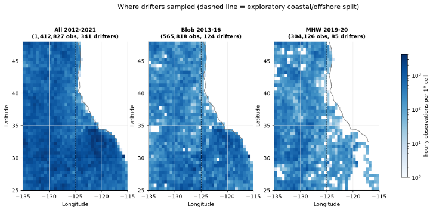</p>

*Figure D1. Hourly GDP observations per 0.5° cell in the study box (25–48°N, 135–115°W): all of 2012–2021 (left), the 2013–2016 Blob (centre) and the 2019–2020 heatwave (right). The dashed line at 125°W was an early coastal/offshore split; the final analysis uses distance to the coastline instead.*

### 8.1 RQ1: Can drifters detect the heatwaves?
**Investigating how effectively drifters detect the Blob and the 2019-2020 marine heatwave** **(Methodology 1)**

**Which model performed better?**

<p align="center">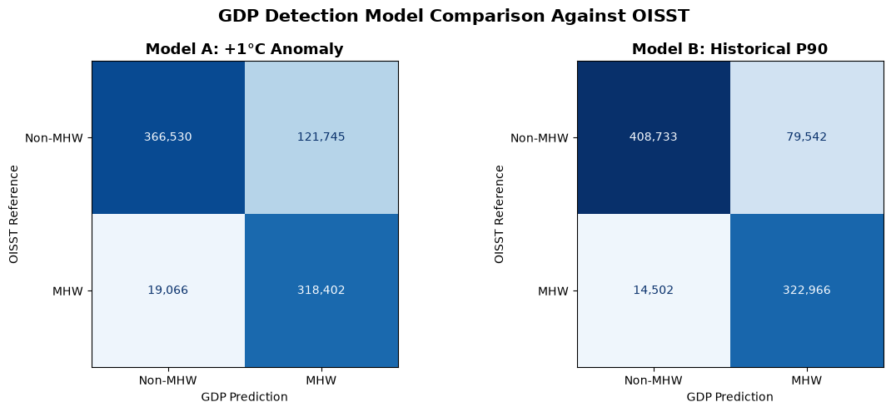</p>

*Figure 1.1. Confusion matrices comparing Model A and Model B*

The confusion matrices compare each model's predictions against the OISST reference, and were used to calculate precision, recall and F1 scores summarised in Table 1.2. Model B correctly identified more marine heatwave observations than Model A (322,966 vs 318,402), reducing false positives by 34.7% and false negatives by 23.9%. Table 1.2 shows Model B achieving higher precision (0.802 vs 0.723), recall (0.957 vs 0.944) and F1 score (0.873 vs 0.819). Moreover, Table 1.3 shows that Model B maintained consistently higher F1 scores across both events (0.874 for the Blob and 0.871 for the 2019-20 MHW), demonstrating stronger and more consistent agreement with the OISST reference.

| **Metric** | **Model A** | **Model B** |
|------------|-------------|-------------|
| Precision  | 0.723       | 0.802       |
| Recall     | 0.944       | 0.957       |
| F1 Score   | 0.819       | 0.873       |

*Table 1.2. Performance statistics for Model A and B*

| **Event**      | **Model A F1** | **Model B F1** |
|----------------|----------------|----------------|
| 2013-2016 Blob | 0.832          | 0.874          |
| 2019-2020 MHW  | 0.786          | 0.871          |

*Table 1.3. Event-specific F1 scores for Model A and B*

**Do the models effectively track the timing and location of both heatwave events?**

<p align="center">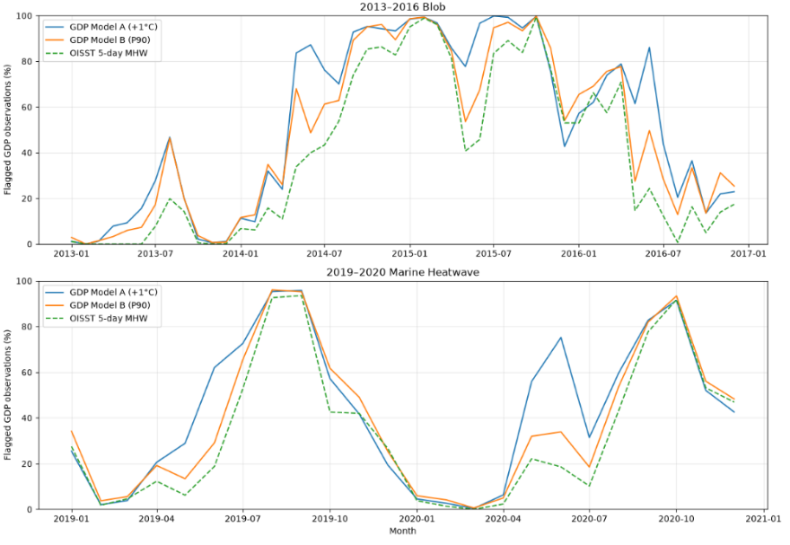</p>

*Figure 1.4. Monthly detection-rate graph for Model A and B during both event periods*

To assess how effectively Models A and B captured the timing of marine heatwave events, their detection rates were compared with the OISST reference, revealing broadly similar temporal patterns. Consistent with its previously observed lower precision, Model A frequently overestimated flagged observations, particularly in June 2020, when it flagged 75% of GDP observations as anomalously warm, compared with 33% for Model B and 20% for OISST. Although Model B also overestimated detection rates during certain periods, it generally aligned more closely with OISST, suggesting that Model A’s fixed threshold was more prone to overidentifying marine heatwave conditions.

**Can the drifters track the spatial distribution of the Blob and the 2019-2020 marine heatwave?**

<p align="center">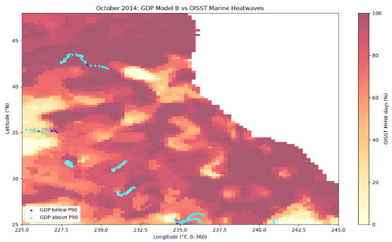 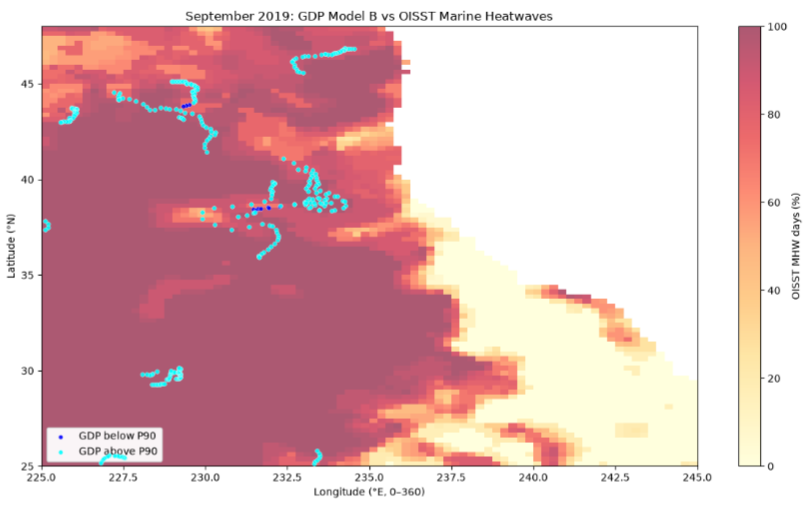</p>

*Figure 1.5. Spatial Maps for October 2014 and September 2019*

| **Event**      | **NOAA**                                                                                              | **Model B**                                                  | **Comparison with NOAA**                                                                                                                                             |
|----------------|-------------------------------------------------------------------------------------------------------|--------------------------------------------------------------|----------------------------------------------------------------------------------------------------------------------------------------------------------------------|
| October 2014   | Strong positive SST anomalies in parts of the northeast Pacific, with cooler regions farther offshore | 95.02% P90 exceedances (4,280 observations from 8 drifters)  | GDP detected unusually warm temperatures in areas where NOAA also showed warming. But limited drifter coverage makes it difficult to assess cooler, offshore regions |
| September 2019 | Widespread offshore warming, with weaker warming in some coastal areas                                | 95.24% P90 exceedances (6,785 observations from 13 drifters) | Warm temperature detected by GDP across locations consistent with NOAA’s offshore warming, however the coastal areas were less well represented by drifters.         |

*Table 1.6. Model performance comparison between Model B and NOAA’s Blobtracker evidence in October 2014 and September 2019*

The spatial distribution maps in Figure 1.5 assess how accurately GDP drifters capture marine heatwave conditions relative to the OISST reference data. In October 2014, OISST indicated widespread warming, while September 2019 showed stronger offshore warming and weaker coastal warming. As shown in Table 1.6, these patterns broadly aligned with NOAA's BlobTracker observations, although some differences in cooler offshore regions during October 2014 were different. Overall, Model B identified unusually warm conditions at sampled locations, but the limited and uneven drifter coverage restricted its ability to capture the full spatial extent of both marine heatwaves. This suggests that GDP observations are better suited for identifying localised warming rather than mapping entire marine heatwave events.

**Methodology 1 results:**

**Test 1: Was a historical SST trend observed in the study region during 1983-2012?** <p align="center">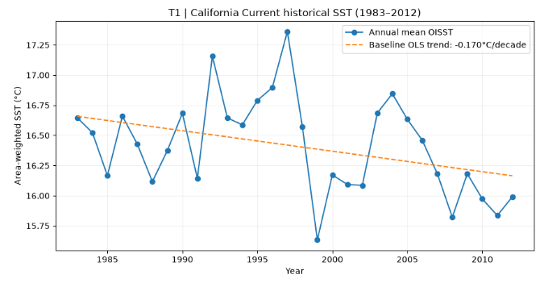</p>

*Figure 1.7. Annual mean SST and estimated linear trend in California Current (1983–2012)*

Overall, a historical SST trend of -0.170°C per decade was estimated, indicating an overall cooling trend during the baseline period. It was found that this negative trend resulted in progressively lower temperature thresholds for later years, potentially increasing the number of GDP observations classified as anomalously warm. However, further statistical validation is needed to confirm this trend and assess whether fixed historical thresholds are suitable for studying later marine heatwaves.

**Model test sensitivity to different adjustment strengths**

<p align="center">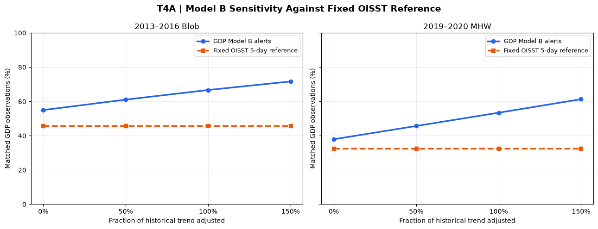</p>

*Figure 1.8. Model B’s sensitivity test against a fixed OISST reference*

<p align="center">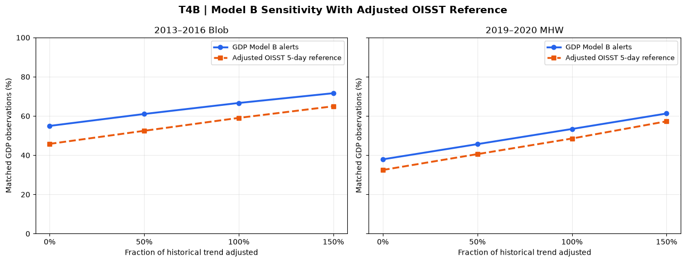</p>

*Figure 1.9. Model B’s sensitivity test against an adjusted OISST reference*

The sensitivity test examined how historical trend adjustments influence Model B’s detections. Increasing the adjustment from 0% to 150% raised the proportion of anomalously warm GDP observations from 55% to 72% during The Blob and 38% to 61% during the 2019–2020 marine heatwave. This occurs because greater detrending lowers the P90 threshold, making SST values more likely to exceed it. Both Model B and the trend-adjusted OISST reference detected more heatwave conditions as the adjustment increased, while the original fixed OISST reference remained unchanged. Overall, these findings demonstrate that Model B’s detections are sensitive to the historical baseline used.

<p align="center">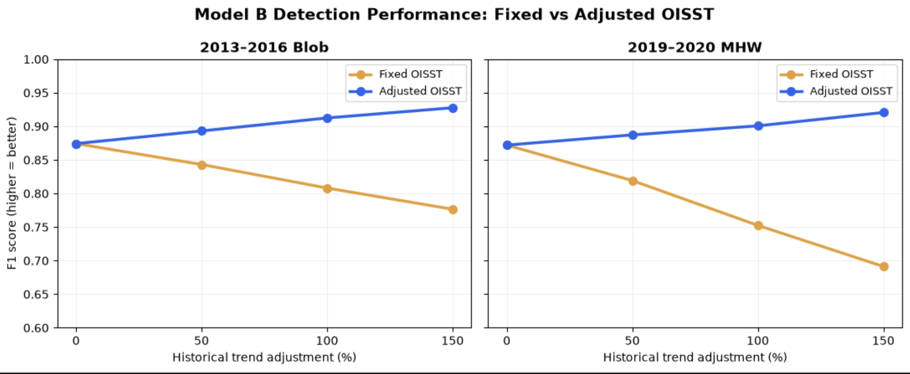</p>

*Figure 1.10. Model B’s detection performance at a fixed OISST vs Adjusted OISST for The Blob and 2019-2020 marine heatwave*

When OISST remained fixed, increasing trend adjustment reduced F1 scores from approximately 0.87 to 0.78 during The Blob and 0.87 to 0.69 during the 2019 marine heatwave, indicating weaker agreement with the original reference. Conversely, when both GDP and OISST thresholds were adjusted, F1 scores increased to approximately 0.93 and 0.92, respectively, indicating greater agreement of anomaly classification when datasets both use progressively lower P90 thresholds. Overall, these findings reinforce the findings from figure 1.7, demonstrating that Model B’s measured performance depends on the baseline and parameters set. While consistent adjustments improve agreement, higher F1 scores do not necessarily indicate greater accuracy or prove that detrending is superior to the original marine heatwave definition.

**Robustness and sensitivity analysis results (Methodology 2):**

<p align="center">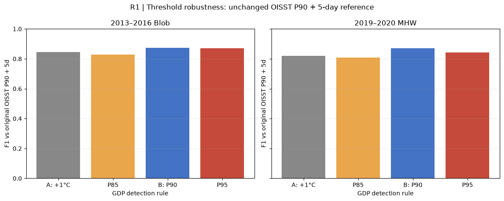</p>

*Figure 1.11. Robustness check of Model B’s detection performance across different GDP thresholds against the fixed OISST P90 five-day reference*

**Is the P90 threshold the most suited threshold for marine heatwave detection?**

Model B’s 90th percentile threshold was initially chosen to stay consistent with the OISST marine heatwave reference definition. Figure 1.11 supports this decision, as P90 achieved the highest F1 scores across both marine heatwave events. However, P95 performed equally well during the 2013-2016 Blob, showing the threshold's effectiveness may vary across datasets, regions and marine heatwave events.

**Test 2: Sensitivity Test for Consecutive Day-Duration**

<p align="center">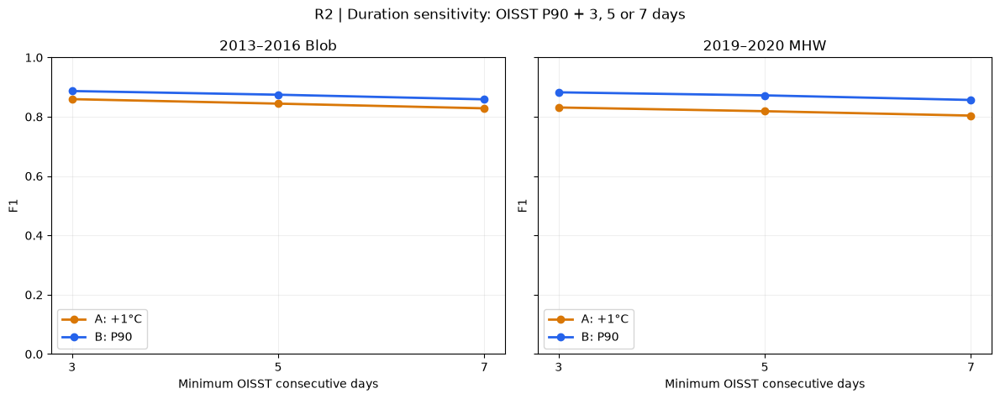</p>

*Figure 1.12. Duration robustness check for Model A and Model B*

**Does changing the heatwave definition drastically affect results?** Following Hobday et al. (2016), marine heatwaves for this project were defined as periods when SST exceeds the historical 90th-percentile threshold for at least five consecutive days. Figure 1.12 shows that F1 scores declined slightly as the minimum duration increased, but Model B consistently outperformed Model A across both marine heatwave events. This indicates that although duration requirement affected F1 scores, it did not change the relative performance of the two models. Therefore, the five-day threshold is a valid and consistent measure with the standard marine heatwave definition.

**Test 3: Threshold Duration Grid**

<p align="center">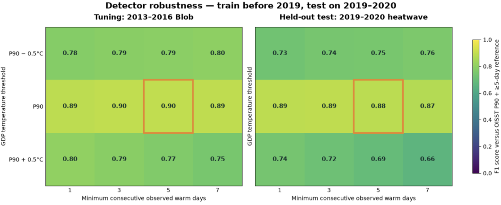</p>

*Figure 1.13. Threshold-duration grid to check how changing both GDP temperature threshold and minimum duration requirement affects detection*

The P90 threshold consistently achieved the highest F1 scores across both marine heatwave events. During The Blob, three-day and five-day durations achieved the highest F1 score of 0.90, whilst one-day and three-day durations performed best during the 2019-2020 marine heatwave (0.89). These findings suggest that longer duration requirements do not necessarily improve detection performance. However, given the minimal F1 difference of 0.01, the model continues to use the five-day requirement established by Hobday et al. (2016) to maintain consistency with the standard marine heatwave definition. Hence, Model B’s chosen parameters of the 90th percentile threshold and five-consecutive-day duration can be considered robust and appropriate, as they maintained performance across the tested variations, with only minor changes in accuracy.

**Test 4: Threshold Tuning and Temporal Generalisation**

<p align="center">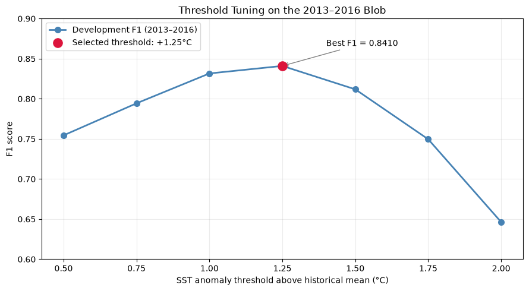</p>

*Figure 1.14. Effect of SST Anomaly Threshold on Model A’s F1 Score during the 2013-2016 Blob*

Seven fixed anomaly thresholds for Model A (+0.5 to +2.0 °C above the historical OISST mean) were tested on the 2013–2016 Blob, and the threshold with the highest F1 score against the OISST P90 five-day reference was chosen (+1.25 °C, F1 0.841). When applied to the holdout 2019-2020 marine heatwave event without modification, the tuned +1.25°C detector achieved a reduced F1 of 0.7988, suggesting a reduction in agreement with the OISST reference compared with the earlier event. In the end, model B still maintained higher F1 scores across both events. However, this was not a completely independent holdout test, so further testing with other events is needed to confirm whether the selected threshold generalises reliably to unseen marine heatwave conditions.

**Event-level forward test.** The second forward test scored every alert rule on regional heatwave events. The best rule on events before December 2018 was P95 for 3 days (F1 0.63), but on the unseen 2019–20 events it scored only 0.58, while the standard definition (P90, 5 days) scored 0.72. Rules tuned to one period overfit it; the standard definition carries over best, which is the data-based reason for keeping P90 and five days. Detection also depends on whether a drifter is nearby: 43% of the 469 events had a drifter nearby, and of those, 56% were detected, with a median delay of 4 days after the heatwave began. Drifters are therefore a useful local check, not a replacement for satellite coverage.

### 8.2 RQ2: How did warm-water movement and coastal exposure differ?
**How did the coastal proximity and entry frequency of GDP drifters differ between the two marine heatwave events?**

<p align="center">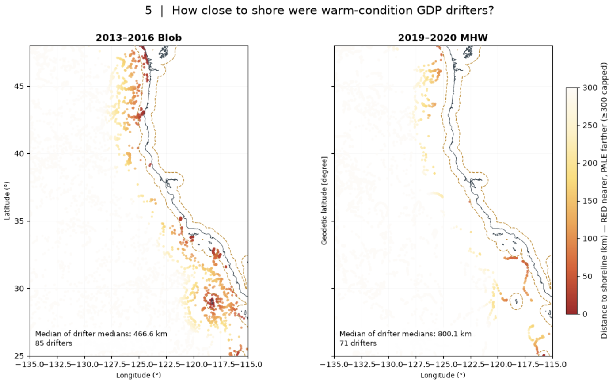</p>

*Figure 2.1. Distance of warm-condition GDP drifters from the mapped coastline during the two marine heatwaves.*

The distance-to-coast analysis in figure 2.1 shows a clear difference between the two marine heatwaves. During the 2013–2016 Blob, the median of the drifter-level median distances was 466.56 km across 85 drifters, compared with 800.10 km across 71 drifters during the 2019–2020 marine heatwave. This difference of approximately 334 km indicates that the sampled warm-condition drifters were generally closer to shore during the Blob. However, the boxplots in figure 2.2 show considerable variation and overlap in coastal distances between the two events, suggesting that not all drifters followed the same spatial patterns.

<p align="center">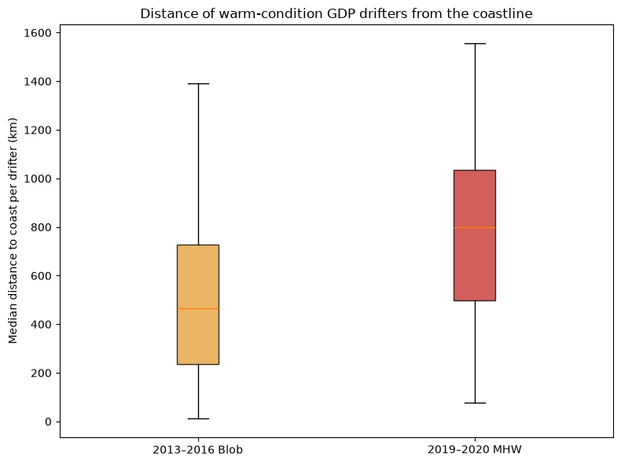</p>

*Figure 2.2. Distribution of drifter-level median distances to the coastline.*

**Coastal entries.** Warm-condition drifters entered the 50 km coastal zone 23 times (13 drifters) during the Blob, against 7 times (3 drifters) in 2019–20. Per 100 offshore drifter-days, this is 1.88 against 0.23 entries, about eight times the rate. Net 24-hour movement was similar (median 10.0 km in the Blob and 11.2 km in 2019–20; Appendix A), so Blob water did not move faster; it was already closer and headed towards the shore more often. This matches Weber et al. (2021): the Blob reached the coast, while 2019–20 stayed offshore as upwelling protected the shelf. The 2019–20 figure rests on only 3 drifters, so its rate is uncertain.

**How accurately could their positions and coastal exposure be predicted 24 hours ahead?**

Figure 2.3 compares the drifters’ actual trajectories with the movements predicted by each model. Model C had the lowest endpoint error at 3.2 km, compared with 4.5 km for Model A and 12.1 km for Model B. For the 2019 marine heatwave, Model C again had the lowest error at 8.9 km, followed by Model B at 14.9 km and Model A at 30.7 km. All models underpredicted drifter movement, but followed the general direction of where the drifter moved. These models will have to be adjusted to improve their predictive accuracy, especially if wanting to be used to predict movement exceeding 24 hours or for the upcoming El Niño.

<p align="center">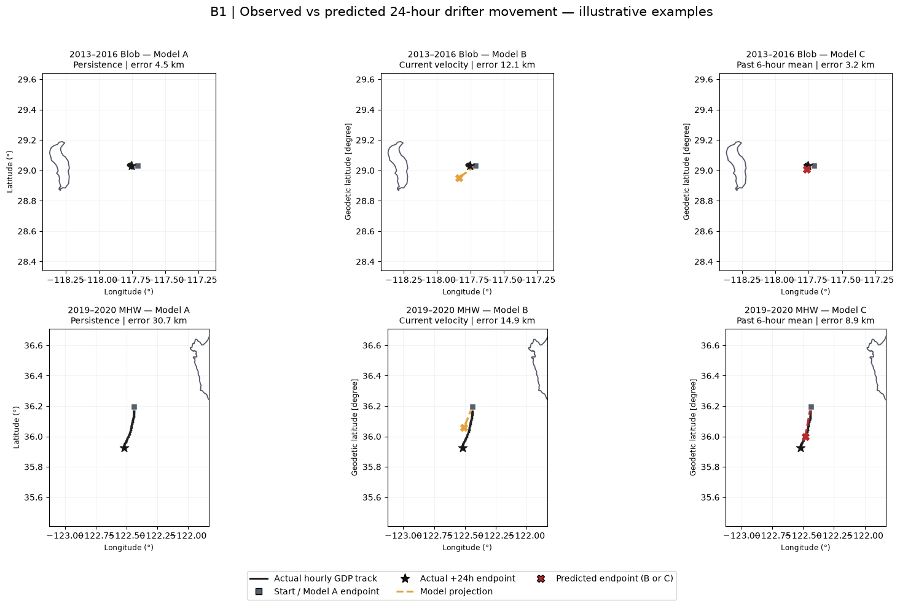</p>

*Figure 2.3. Observed and predicted 24-hour GDP drifter movements under Models A, B and C.*

**Coastal endpoint classification performance**

<table style="width:100%;">
<colgroup>
<col style="width: 14%" />
<col style="width: 14%" />
<col style="width: 14%" />
<col style="width: 14%" />
<col style="width: 14%" />
<col style="width: 14%" />
<col style="width: 14%" />
</colgroup>
<thead>
<tr class="header">
<th></th>
<th colspan="3"><p><strong>2013-16 BLOB</strong></p>
<p><strong>4,717 observed positive endpoints</strong></p></th>
<th colspan="3"><p><strong>2019-20 MHW</strong></p>
<p><strong>82 observed positive endpoints</strong></p></th>
</tr>
<tr class="odd">
<th>Model</th>
<th>Precision</th>
<th>Recall</th>
<th>F1</th>
<th>Precision</th>
<th>Recall</th>
<th>F1</th>
</tr>
<tr class="header">
<th>A</th>
<th>0.927</th>
<th>0.887</th>
<th>0.907</th>
<th>0.390</th>
<th>0.366</th>
<th>0.377</th>
</tr>
<tr class="odd">
<th>B</th>
<th>0.907</th>
<th>0.919</th>
<th>0.913</th>
<th>0.361</th>
<th>0.683</th>
<th>0.473</th>
</tr>
<tr class="header">
<th>C</th>
<th>0.914</th>
<th>0.926</th>
<th>0.920</th>
<th>0.401</th>
<th>0.817</th>
<th>0.538</th>
</tr>
</thead>
<tbody>
</tbody>
</table>

*Table 2.4. 24-hour coastal endpoint classification performance by model and marine heatwave event*

Coastal-endpoint classification assessed whether predicted drifter positions were within 50 km of the mapped coastline after 24 hours. Since most observations were offshore, overall accuracy could be misleading. Instead, three models were evaluated using precision, recall and F1 scores. Model C achieved the highest F1 scores across both events (0.920 for the Blob and 0.538 for the 2019–2020 marine heatwave), with recall scores of 0.926 and 0.817, respectively. Performance was weaker during the 2019-2020 marine heatwave event, where Model C correctly identified 67 of the 82 coastal endpoints but produced 100 false positives, resulting in a low precision of 0.401. These results suggest that Model C was the most effective at identifying coastal endpoints during the Blob, but is less reliable during the later event. However, this evaluation measured coastal presence after 24 hours instead of new coastal entries, as some drifters may have already been within the coastal zone.

**Temperature persistence**

<p align="center">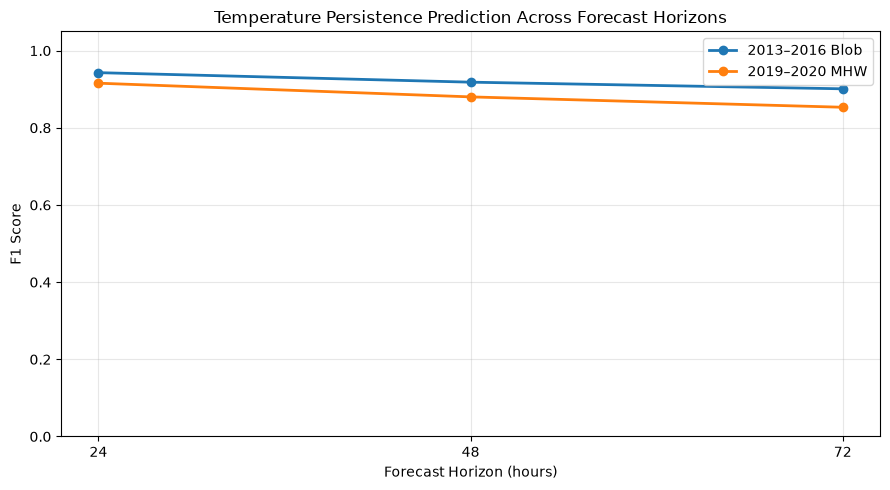</p>

*Figure 2.5. Warm-class F1 scores for the temperature-persistence baseline at forecast horizons of 24, 48 and 72 hours during the 2013–2016 Blob and the 2019–2020 marine heatwave.*

The temperature-persistence baseline assumed that a drifter’s current warm/non-warm classification would remain unchanged. At 24 hours, the warm-class F1 score was 0.943 for the Blob and 0.916 for the 2019–2020 marine heatwave. In figure 2.5, F1 declined at 48 and 72 hours, although the Blob consistently achieved slightly higher scores. This indicates that the initial temperature classification became less reliable over longer forecast periods. However, these results only assess whether drifters are classified as warm at the observed future locations, not whether temperatures remained continuously warm throughout their movement.

Overall, warm-condition drifters were generally closer to the shore and recorded more coastal entries during the Blob than the 2019-2020 marine heatwave. Among the three prediction models, Model C achieved the highest coastal-endpoint F1 scores and the lowest median 24-hour position errors. The temperature-persistence baseline also performed well at 24 hours, although its F1 scores declined at longer forecast horizons. However, uneven drifter coverage and the limited number of coastal endpoints during 2019-2020 limit how broadly these findings can be applied.

### 8.3 RQ3: Did the exposure reach the fish?
**Are the temperatures right?** Drifter SST matched ship SST at egg samples closely: 663 pairs within 50 km and one day, mean difference −0.08 °C, correlation 0.93. OISST matched ship SST with no average bias across all 17,269 samples (standard deviation 0.82 °C). The temperatures used are therefore the ones the eggs were sampled in, although OISST already includes ship and drifter data, so this is a consistency check rather than independent proof.

**Exposure of spawning habitat.** During the Blob, 44% \[33–55\] of spring samples in the core area were in a heatwave, against 10% \[3–18\] in 2019–20 and 1% before the Blob (Table 3.1, Figure 3.2). The intervals do not overlap: the Blob exposed spawning habitat about four times as often, which agrees with RQ2. Yet even at its peak, only 8% of samples were above the sardine upper limit (17 °C) and 15% above the anchovy limit (16.5 °C). The Blob made habitat unusually warm for the place and season far more often than it made it too hot for the fish. Drifters in the same area and season showed the same contrast (59% vs 19% of drifter-days in a heatwave), from 25 and 6 drifters.

| Period            | In a heatwave that day | Heatwave days in previous 30 | Above sardine limit | Above anchovy limit |
|-------------------|------------------------|------------------------------|---------------------|---------------------|
| Before (2012–13)  | 1% \[0–3\]             | 1%                           | 1% \[0–2\]          | 2% \[0–4\]          |
| Blob (2014–16)    | 44% \[33–55\]          | 49%                          | 8% \[3–14\]         | 15% \[8–22\]        |
| Between (2017–18) | 5% \[2–9\]             | 9%                           | 0%                  | 3% \[1–7\]          |
| 2019–20           | 10% \[3–18\]           | 16%                          | 2% \[0–5\]          | 8% \[1–18\]         |

*Table 3.1. Share of spring egg-survey samples (31.5–35.5°N) exposed, with 95% intervals from a bootstrap over survey days. 2021 is left out (10 survey days).*

<p align="center">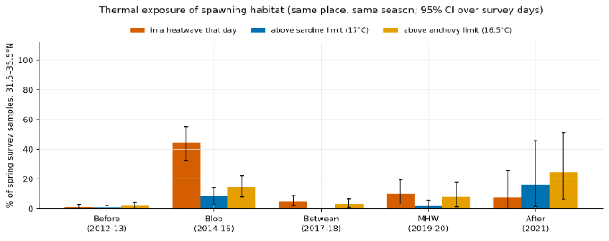</p>

*Figure 3.2. Heat exposure of spawning habitat by period: share of spring samples in a heatwave and above each species’ upper limit, with 95% intervals.*

**Where fish spawned.** Sardine eggs nearly disappeared from the core area during the Blob, falling from 26% \[19–33\] to 2% \[1–4\] of samples, and the median latitude of sardine eggs moved from 34.9°N to 42.6°N, about 850 km north, off Oregon (Figure 3.3). The water temperature where sardine eggs were found barely changed (12.9 to 12.8 °C): sardines appear to have moved with their preferred water rather than putting up with warmer water. Anchovy did the opposite. Their egg presence rose from 0% before to 5% during, 29% between and 36% in 2019–20, without moving north, matching the known anchovy boom after the Blob (Thompson et al., 2022; Free et al., 2023). The northern survey lines (38°N and above) were only sampled in spring 2012, 2015 and 2016, so the latitude shift compares exactly those years and rests on a small 2012 baseline.

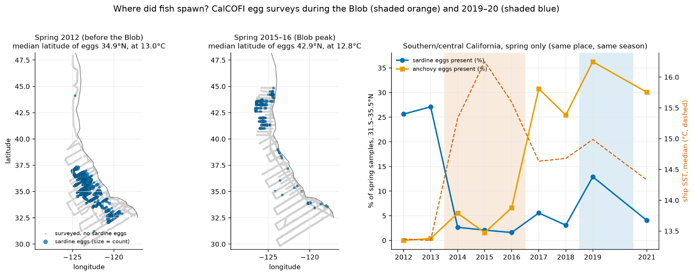

*Figure 3.3. Spring sardine egg samples in 2012 (before the Blob) and 2015–16 (Blob peak); grey points were surveyed with no sardine eggs. Right: yearly share of spring samples with eggs in the 31.5–35.5°N core, with median ship SST.*

**Is exposure linked to where eggs occur?** Maps can mislead, so the link was tested with nine models per species (three sets at three input levels), each predicting years it had not seen (Table 3.4, Figure 3.5). For sardine, adding heatwave exposure (C − A) improved prediction in every set, with every interval above zero: +0.015 for the rule-based overlay, +0.084 for logistic regression and +0.029 for gradient boosting. Within the logistic set, each step added skill: AUC 0.584 (A), 0.633 (B), 0.669 (C). For anchovy, the gain was clear only in the logistic set (+0.015) and was about zero or negative in the others.

*Table 3.4. Gain in leave-one-year-out ROC-AUC from adding heatwave exposure within each model set, with 95% bootstrap intervals, and the set chosen by the decision rule.*

| Species          | Rule-based gain (C − A)   | Logistic gain (C − A)     | Boosting gain (C − A)     | Chosen set, best model (AUC)  |
|------------------|---------------------------|---------------------------|---------------------------|-------------------------------|
| Pacific sardine  | +0.015 \[+0.004, +0.025\] | +0.084 \[+0.059, +0.113\] | +0.029 \[+0.016, +0.043\] | Gradient boosting C (0.721)   |
| Northern anchovy | +0.007 \[−0.000, +0.015\] | +0.015 \[+0.006, +0.024\] | −0.002 \[−0.009, +0.005\] | Logistic regression C (0.789) |

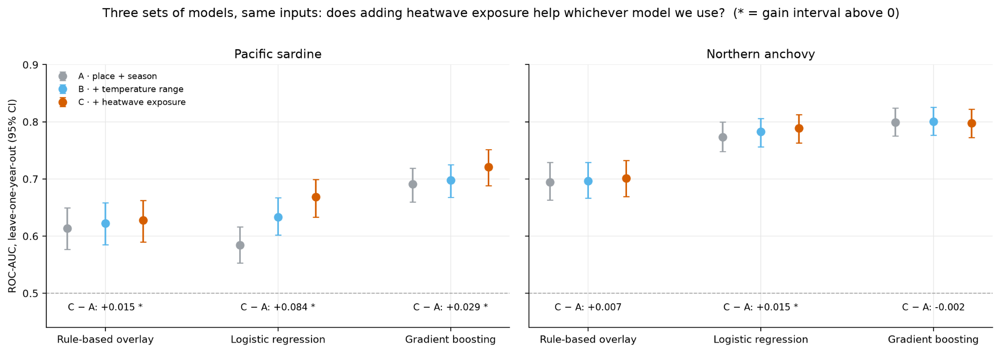

*Figure 3.5. Leave-one-year-out ROC-AUC of every egg model, grouped by model set, for sardine and anchovy (95% intervals). Text shows the gain from adding heatwave exposure (C − A); an asterisk marks an interval above zero.*

**Choosing the best set.** For sardine, gradient boosting is clearly better than the logistic (0.669) and rule-based (0.628) sets, so the decision rule accepts its extra complexity: sardine’s response to temperature depends on latitude and season together, which trees can capture. For anchovy, logistic regression (0.789) is the simplest set not clearly worse than boosting (0.801), so it is chosen. The rule-based overlay, the original proposal idea, was weakest for both species (0.63 and 0.70), so an overlay alone would have under-used the data.

**Robustness.** The sardine gain stayed positive when the species ranges were shifted by −2 to +2 °C (+0.035 to +0.085) and for exposure windows of 10, 30 and 60 days (+0.062 to +0.099), and was largest near the published range. Anchovy gains stayed small and turned slightly negative at −1 °C.

**Limits of the models.** No model reproduces the size of the sardine collapse or the anchovy boom, and predicted probabilities were no better calibrated with exposure (Brier score unchanged). The models capture where eggs are likely within a survey, not how many fish there are. An AUC of 0.72 is moderate, but fish eggs are very patchy, and the gain over place and season is consistent across model types.

**RQ3 answer.** The Blob exposed spawning habitat to heatwave conditions about four times as often as 2019–20, although most water stayed inside the species’ ranges. Sardine spawning moved about 8° north into water of the same temperature, and heatwave exposure improved predictions of where sardine eggs occur in every model set and under every range and window tested. For anchovy, exposure did not reliably help, which agrees with evidence that the anchovy boom was driven by larval survival and food rather than temperature (Swalethorp et al., 2023; Robidas et al., 2026). This is a link, not proof of cause.

### 8.4 Putting the research questions together
The three questions form one chain. Drifters can detect heatwave conditions where they are (RQ1). What separated the damaging event from the less damaging one was coastal reach, not size: warm Blob water sat about 330 km closer to shore and entered the coastal zone about eight times as often (RQ2). That coastal exposure lined up with a real shift in where a commercially important fish spawned: four times more spawning habitat was in a heatwave, and sardine spawning moved about 8° north (RQ3). This is the same fish whose collapse led to a multi-year federal fishery disaster (Free et al., 2023).

Two results were unexpected. First, “unusually warm for the place” mattered more than “too hot for the fish”: sardines moved even though most exposed water stayed within their range. Second, anchovy did well after the Blob for reasons temperature does not explain. Muhling et al. (2020) also found that sardine shifted and anchovy did not during the Blob, and that distribution models lose skill in new conditions; the forward tests and the leave-one-year-out design were chosen with that risk in mind.

## 9. Results and Findings
Drifters detect heatwave conditions locally, the two events differed mainly in coastal reach, and that reach lined up with a northward shift in sardine spawning.

| Question   | Answer                                                                                                                                                          | Key evidence                                                                                                                                                                       | Uncertainty                                                                                                                                  |
|------------|-----------------------------------------------------------------------------------------------------------------------------------------------------------------|------------------------------------------------------------------------------------------------------------------------------------------------------------------------------------|----------------------------------------------------------------------------------------------------------------------------------------------|
| RQ1 Detect | Yes, where drifters are. The 90th-percentile detector (Model B) is best.                                                                                        | F1 0.873 vs 0.819; F1 0.874 and 0.871 in each event; on the unseen 2019–20 events, F1 0.72 for P90/5 days vs 0.58 for a tuned rule; median alert delay 4 days                      | Only 43% of regional events had a drifter nearby; agreement is partly built in because OISST includes drifter SST |
| RQ2 Track  | Sampled warm-condition drifters were closer to shore during the Blob. Model C performed best among the three trajectory models in the retrospective comparison. | Median coastal distance: 466.56 vs 800.10 km; Model C coastal F1: 0.920 vs 0.538                                                                                                   | Uneven drifter coverage; rare coastal endpoints; retrospective evaluation                                                                    |
| RQ3 Impact | Blob exposure was about four times higher. Sardine spawning moved north with it; anchovy did not.                                                               | 44% \[33–55\] vs 10% \[3–18\] of samples in a heatwave; sardine eggs 26% to 2%, 34.9°N to 42.6°N at the same 12.8 °C; exposure gain in all three sardine model sets, best AUC 0.72 | A link, not cause; northern lines sampled in 3 springs only; little 2019–20 egg data; models do not predict fish numbers                     |

### Recommendation
NOAA and the GDP should use drifter observations as a **local, real-time check alongside the Blobtracker**, not as a replacement:

1.  **Flag with the 90th-percentile rule.** Flag drifter observations above the OISST 90th percentile using the standard five-day definition. It matched OISST best and carried over best to an unseen event; tuned alternatives overfit.

2.  **Watch coastal reach, not just size.** For a detected heatwave, track the share of warm-condition drifters near the coast and their coastal-entry rate. This, not area, separated the damaging Blob from the 2019–20 event, and NOAA explains NEP25A’s smaller impact so far in the same way.

3.  **Treat shoreward warm water as an early signal for sardine.** When warm water is heading towards the shore in spring, sardine spawning grounds off southern and central California are the first place to look for a northward shift. For 2026–27, with NEP25A growing off the southern West Coast and a strong El Niño likely, this is a monitoring priority, not a forecast of fish numbers.

4.  **Do not rely on temperature alone for anchovy.** Their response was not explained by heat exposure.

## 10. Limitations
**No recent data.** The GDP hourly release ends in October 2022, so NEP25A and the 2026–27 El Niño could not be studied directly. Statements about 2026–27 are indirect and should not be read as evidence of current conditions or impacts.

**Uneven drifter coverage.** Drifters follow currents and sample narrow paths. Only 43% of regional heatwave events had a drifter nearby, and the 2019–20 coastal results rest on 7 coastal entries from 3 drifters. Drifters are a local check, not a map.

**The reference is not independent.** OISST already includes drifter and ship SST, and Model B shares its 90th-percentile threshold, so some agreement is expected. The drifter–ship and OISST–ship checks show consistency, not independent proof.

**Gaps in the satellite record.** NOAA's ERDDAP copy of OISST has missing days in 1992–1998; these partial years were kept in the 1982–2011 climatology.

**Drogue status.** Although velocity coverage is high, drifter velocity may also depend on drogue status. The drogue acts as a sea anchor and allows the buoy to more closely follow subsurface water motion; after drogue loss, recorded velocity can be more affected by wind slip. The current preliminary analysis does not explicitly separate observations by drogue status, so this potential source of bias should be considered when interpreting transport and coastal-exposure results.

**Fish data.** Comparing the Blob and the 2019-20 Marine heatwave to relevant fish egg data was challenging due to difficulties aligning datasets spatially and temporally. Fish egg surveys were limited for 2019-2020 and only reflected spawning activity rather than overall fish abundance. Additionally, pre-existing declines in sardine populations made it difficult to isolate the impacts of marine heatwaves on fisheries.

## 11. Future Work
Future research could extend this study by predicting marine heatwave patterns and hotspots associated with the anticipated 2026-2027 El Niño, once more recent drifter data from NEP25A and NEP26A becomes available. Building on RQ2, the trajectory models could be extended beyond 24 hours and evaluated against later GDP positions. Temperature-persistence evaluation could also be extended beyond the 72-hour horizon already tested. Additionally, future studies could incorporate fish population and catch data, rather than relying solely on fish eggs, provided sufficient spatially and temporally aligned datasets become available. This approach could also be expanded to investigate the impacts of marine heatwaves on other declining marine species and flora.

## 12. Installation and Reproducibility

### Install

The code runs in Python 3.12. From the project folder:

```bash
python -m venv .venv
source .venv/bin/activate          # Windows: .venv\Scripts\activate
pip install -r requirements.txt
```

`requirements.txt` lists numpy, pandas, pyarrow, xarray, netCDF4, zarr, scipy, scikit-learn, matplotlib, clouddrift, geopandas, shapely, pyproj, requests and jupyter.

### Run order

| Step | File | What it does | Outputs | Report |
|---|---|---|---|---|
| 1 | [`01_download_data.ipynb`](01_download_data.ipynb) | Downloads GDP hourly data with clouddrift and cuts it to 25–48°N, 135–115°W, 2012–2021 | `data/processed/california_current_new.zarr` | 7.1 |
| 2 | [`02_eda.ipynb`](02_eda.ipynb) | Exploratory checks of SST quality, coverage and early anomaly maps | exploratory figures | 7.1 |
| 2b | [`02b_data_coverage.py`](02b_data_coverage.py) | Observations and drifters per period and the coverage maps | Figure D1, `table_D1_coverage.csv` (run step 6 once first: it downloads the drifter file this uses) | 8 |
| 3 | [`03_OISST_climatology.ipynb`](03_OISST_climatology.ipynb) | Downloads OISST, builds the 1982–2011 mean and 90th-percentile climatology and the 2013–2020 heatwave reference | `data/processed/oisst_*.nc` | 7.2, 7.3 |
| 4 | [`04_RQ1_heatwave_detection.ipynb`](04_RQ1_heatwave_detection.ipynb) | RQ1 detectors, evaluation and sensitivity tests | Section 8.1 figures and tables | 7.4, 8.1 |
| 5 | [`05_RQ2_coastal_drifters.ipynb`](05_RQ2_coastal_drifters.ipynb) | RQ2 coastal exposure, trajectory models and persistence | Section 8.2 figures and tables, A2, A3 | 7.5, 8.2 |
| 6 | [`06_RQ3_species_exposure.py`](06_RQ3_species_exposure.py) | RQ3 exposure, spawning shift, egg models, sensitivity | Tables 3.1, 3.4; Figures 3.2, 3.3, 3.5 | 7.6, 8.3 |
| 7 | [`07_RQ1_event_forward_test.ipynb`](07_RQ1_event_forward_test.ipynb) | Regional heatwave events, event-level forward test and detection delay | `table_rq3_rule_holdout.csv`, `table_rq3_detection_summary.csv` | 7.4, 8.1 |

For example, to reproduce Table 3.4 and Figure 3.5, run `python 06_RQ3_species_exposure.py`; the results appear in `figures/rq3/table_B3b_model_sets.csv` and `figures/rq3/figB3b_model_sets.png`.

### Data access and reproducibility notes

- **Downloads.** Every step checks for cached data and downloads anything missing from NOAA (clouddrift for GDP, ERDDAP for OISST and CUFES). The first full download takes over an hour; later runs use the cache.
- **OISST gaps.** NOAA's ERDDAP copy of OISST is missing days in 1992–1998. The loaders reject any cached year with too few days, download it again, and keep partial years with at least 100 days.
- **Fixed seeds.** All random steps (bootstrap intervals, gradient boosting) use seed 42, so a re-run gives the same numbers. `06_RQ3_species_exposure.py` was re-run from scratch and matched every RQ3 table in this report.
- **Run time.** Steps 2b and 6 take about 3 minutes each on a laptop; step 4 needs about 4 GB of RAM because it loads the full OISST grid.

## References
Bond, N. A., Cronin, M. F., Freeland, H., & Mantua, N. (2015). Causes and impacts of the 2014 warm anomaly in the NE Pacific. Geophysical Research Letters, 42(9), 3414–3420. https://doi.org/10.1002/2015GL063306

Cavole, L. M., Demko, A. M., Diner, R. E., Giddings, A., Koester, I., Pagniello, C. M. L. S., Paulsen, M.-L., Ramirez-Valdez, A., Schwenck, S. M., Yen, N. K., Zill, M. E., & Franks, P. J. S. (2016). Biological impacts of the 2013–2015 warm-water anomaly in the Northeast Pacific: Winners, losers, and the future. Oceanography, 29(2), 273–285. https://doi.org/10.5670/oceanog.2016.32

Checkley, D. M., Ortner, P. B., Settle, L. R., & Cummings, S. R. (1997). A continuous, underway fish egg sampler. Fisheries Oceanography, 6(2), 58–73.

Di Lorenzo, E., & Mantua, N. (2016). Multi-year persistence of the 2014/15 North Pacific marine heatwave. Nature Climate Change, 6(11), 1042–1047. https://doi.org/10.1038/nclimate3082

Elipot, S., Lumpkin, R., Perez, R. C., Lilly, J. M., Early, J. J., & Sykulski, A. M. (2016). A global surface drifter data set at hourly resolution. Journal of Geophysical Research: Oceans, 121(5), 2937–2966. https://doi.org/10.1002/2016JC011716

Elipot, S., Sykulski, A., Lumpkin, R., Centurioni, L., & Pazos, M. (2022). A dataset of hourly sea surface temperature from drifting buoys. Scientific Data, 9, 567. https://doi.org/10.1038/s41597-022-01670-2

Elipot, S., Miron, P., Curcic, M., Santana, K., & Lumpkin, R. (2024). Clouddrift: A Python package to accelerate the use of Lagrangian data for atmospheric, oceanic, and climate sciences. Journal of Open Source Software, 9(99), 6742. https://doi.org/10.21105/joss.06742

Free, C. M., Anderson, S. C., Hellmers, E. A., Muhling, B. A., Navarro, M. O., Richerson, K., Rogers, L. A., Satterthwaite, W. H., Thompson, A. R., Burt, J. M., Gaines, S. D., Marshall, K. N., White, J. W., & Bellquist, L. F. (2023). Impact of the 2014–2016 marine heatwave on US and Canada West Coast fisheries: Surprises and lessons from key case studies. Fish and Fisheries, 24(4), 652–674. https://doi.org/10.1111/faf.12753

Hobday, A. J., Alexander, L. V., Perkins, S. E., Smale, D. A., Straub, S. C., Oliver, E. C. J., Benthuysen, J. A., Burrows, M. T., Donat, M. G., Feng, M., Holbrook, N. J., Moore, P. J., Scannell, H. A., Sen Gupta, A., & Wernberg, T. (2016). A hierarchical approach to defining marine heatwaves. Progress in Oceanography, 141, 227–238. https://doi.org/10.1016/j.pocean.2015.12.014

Huang, B., Liu, C., Banzon, V., Freeman, E., Graham, G., Hankins, B., Smith, T., & Zhang, H.-M. (2021). Improvements of the Daily Optimum Interpolation Sea Surface Temperature (DOISST) Version 2.1. Journal of Climate, 34(8), 2923–2939. https://doi.org/10.1175/JCLI-D-20-0166.1

Lluch-Belda, D., Lluch-Cota, D. B., Hernández-Vázquez, S., Salinas-Zavala, C. A., & Schwartzlose, R. A. (1991). Sardine and anchovy spawning as related to temperature and upwelling in the California Current system. CalCOFI Reports, 32, 105–111. https://calcofi.com/publications/calcofireports/v32/Vol_32_Lluch-Belda_etal.pdf

Muhling, B. A., Brodie, S., Smith, J. A., Tommasi, D., Gaitan, C. F., Hazen, E. L., Jacox, M. G., Auth, T. D., & Brodeur, R. D. (2020). Predictability of species distributions deteriorates under novel environmental conditions in the California Current System. Frontiers in Marine Science, 7, 589. https://doi.org/10.3389/fmars.2020.00589

NOAA California Current Integrated Ecosystem Assessment. (2026). California Current Marine Heatwave Tracker. Retrieved November 21, 2026, from https://www.integratedecosystemassessment.noaa.gov/regions/california-current/cc-projects-blobtracker

NOAA Climate Prediction Center. (2026, November 12). ENSO diagnostic discussion. https://www.cpc.ncep.noaa.gov/products/analysis_monitoring/enso_advisory/ensodisc.shtml

NOAA National Centers for Environmental Information. (2026). Daily Optimum Interpolation SST v2.1 (ERDDAP dataset ncdcOisst21Agg_LonPM180) \[Data set\]. Retrieved November 2026 from https://coastwatch.pfeg.noaa.gov/erddap/griddap/ncdcOisst21Agg_LonPM180.html

NOAA Southwest Fisheries Science Center. (2026). CalCOFI Continuous Underway Fish-Egg Sampler (CUFES) data (ERDDAP dataset erdCalCOFIcufes) \[Data set\]. Retrieved November 2026 from https://coastwatch.pfeg.noaa.gov/erddap/tabledap/erdCalCOFIcufes.html

Pedregosa, F., Varoquaux, G., Gramfort, A., Michel, V., Thirion, B., Grisel, O., Blondel, M., Prettenhofer, P., Weiss, R., Dubourg, V., Vanderplas, J., Passos, A., Cournapeau, D., Brucher, M., Perrot, M., & Duchesnay, É. (2011). Scikit-learn: Machine learning in Python. Journal of Machine Learning Research, 12, 2825–2830.

Responsible Seafood Advocate. (2026, March 6). NOAA scientists track massive marine heatwave affecting U.S. West Coast waters. Global Seafood Alliance. https://www.globalseafood.org/advocate/noaa-scientists-track-massive-marine-heatwave-affecting-u-s-west-coast-waters/

Robidas, M. L., Swalethorp, R., Gomes, D. G. E., Semmens, B. X., Searcy, S., Fiechter, J., Seale, M., Hinchliffe, C., Fennie, H. W., Muhling, B., & Thompson, A. R. (2026). Larval condition helps explain the recent anchovy boom in an extremely warm California Current Ecosystem. ICES Journal of Marine Science, 83(7), fsag124. https://doi.org/10.1093/icesjms/fsag124

Salazar, A. (2026, October 11). El Niño jolts Peru’s fisheries: Anchoveta catch plunges 99% as jumbo squid gains ground amid expert monitoring. Latin Times. https://www.latintimes.com/el-nino-jolts-perus-fisheries-anchoveta-catch-plunges-99-jumbo-squid-gains-ground-amid-expert-600042

Swalethorp, R., Landry, M. R., Semmens, B. X., Ohman, M. D., Aluwihare, L., Chargualaf, D., & Thompson, A. R. (2023). Anchovy boom and bust linked to trophic shifts in larval diet. Nature Communications, 14. https://doi.org/10.1038/s41467-023-42966-0

Thompson, A. R., Ben-Aderet, N. J., Bowlin, N. M., Kacev, D., Swalethorp, R., & Watson, W. (2022). Putting the Pacific marine heatwave into perspective: The response of larval fish off southern California to unprecedented warming in 2014–2016 relative to the previous 65 years. Global Change Biology, 28(5), 1766–1785. https://doi.org/10.1111/gcb.16010

UNSW DATA3001. (2026). The Global Drifter Program hourly dataset \[Course brief\]. DATA3001 Data Science and Decisions in Practice, Term 3 2026, UNSW Sydney.

Valencia-Gasti, J. A., Weber, E. D., Baumgartner, T., Durazo, R., McClatchie, S., & Lennert-Cody, C. E. (2018). Spring spawning distribution of Pacific sardine in US and Mexican waters. CalCOFI Reports, 59, 79–85. https://calcofi.com/publications/calcofireports/v59/Vol59-Valencia-etal_79-85.pdf

Weber, E. D., Auth, T. D., Baumann-Pickering, S., Baumgartner, T. R., Bjorkstedt, E. P., Bograd, S. J., Burke, B. J., Cadena-Ramírez, J. L., Daly, E. A., de la Cruz, M., Dewar, H., Field, J. C., Fisher, J. L., Giddings, A., Goericke, R., Gomez-Ocampo, E., Gomez-Valdes, J., Hazen, E. L., Hildebrand, J., … Zeman, S. M. (2021). State of the California Current 2019–2020: Back to the future with marine heatwaves? Frontiers in Marine Science, 8, 709454. https://doi.org/10.3389/fmars.2021.709454

## Appendix A: RQ2 supplementary analyses
**Observed 24-hour net displacement**

<p align="center">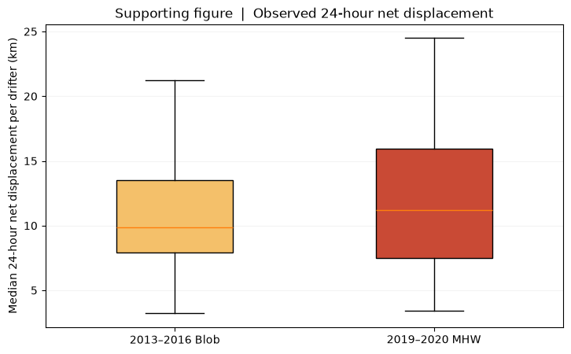</p>

*Figure A2. Distributions of drifter-level median 24-hour net displacement during the 2013–2016 Blob and the 2019–2020 marine heatwave.*

The median of the drifter-level displacement values was approximately 10 km during the Blob and 11.2 km during 2019–2020. The later event therefore showed slightly greater net displacement, although the distributions overlapped considerably. Net displacement measures the separation between starting and ending positions. Greater displacement does not necessarily indicate movement towards the coast, because drifters may also move offshore or parallel to the coastline.

**Accuracy of predicted 24-hour GDP drifter positions**

<p align="center">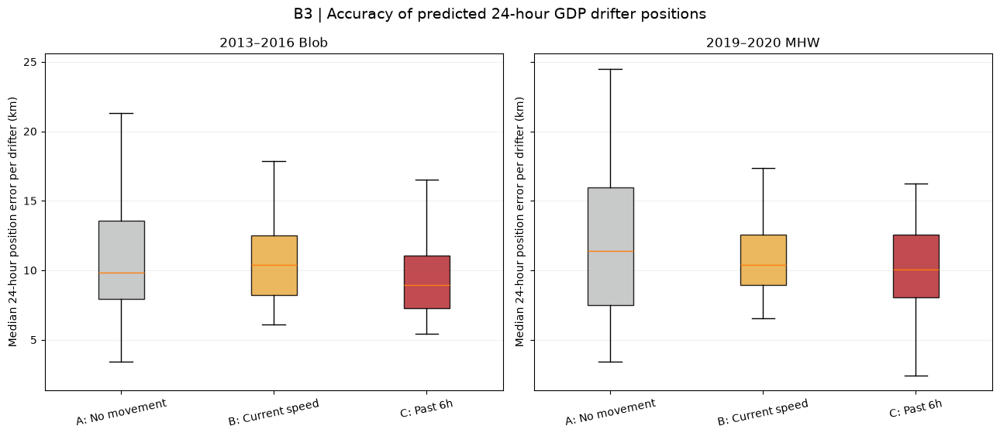</p>

*Figure A3. Distributions of drifter-level median 24-hour position errors for Models A, B and C during the two marine heatwaves. Position error is the geographical distance between the predicted and observed endpoint.*

Model C had the lowest median of the drifter-level error values in both events. However, the distributions overlapped, and these aggregate summaries do not establish that Model C performed better for every individual drifter. These results describe retrospective position estimates; further evaluation is required to establish performance under real-time forecasting conditions.

## Appendix B: Reflection on AI Use
AI tools (ChatGPT and Claude) were used to search for literature and datasets, debug code, plan model comparisons, and draft and check text. All numbers in this report come from the project code, and every reference was opened and checked against its source.

**Where AI helped**

- **Finding the fish data.** An AI-assisted search pointed to NOAA's CalCOFI CUFES egg data, which became the independent fish dataset for RQ3.

- **Fixing the OISST download.** The first loader silently saved empty files for 1982–1990 and gappy files for 1992–1998, which would have distorted the 90th-percentile baseline. AI help traced this to the download request and replaced it with direct ERDDAP downloads plus a check that rejects any year with too few days (Section 7.7).

- **Planning model comparisons.** AI suggested comparing whole model sets (rule-based, logistic regression, gradient boosting) with nested inputs and a stated decision rule, which shaped the RQ3 design and the RQ1 event-level forward test.

**Where AI was wrong, and how it was caught**

- **A wrongly attributed temperature range.** An AI-drafted note credited a sardine range of 12–17 °C to Valencia-Gasti et al. (2018). The paper itself reports that most eggs were found below 17 °C and at average SSTs of 13.0–14.3 °C in US waters. The range was kept as a working choice, described accurately in Section 7.6, and tested with ±2 °C shifts.

- **Changing the research question.** At one point AI recommended replacing RQ3 with a question about detection timing. That moved away from the proposal and its motivation, so the species-exposure question was kept and the timing work became supporting analysis for RQ1.

- **Outdated and garbled facts.** AI-assisted drafts carried an older “greater than 90%” El Niño probability, which was updated to NOAA's latest outlook. A citation generator also turned the GDP author “Centurioni, L.” into “Luca, C.”, which was corrected.

Overall, AI was most useful for finding data and debugging, and least reliable for facts and citations, which is why every number was traced back to code output and every reference to its source.
